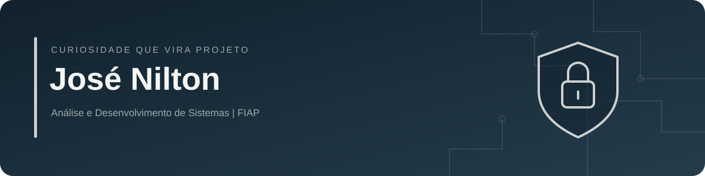

  

  <a href="https://www.linkedin.com/in/jos%C3%A9-nilton-a1b8b6280/">LinkedIn</a> ·
  <a href="https://almeidanilton.github.io/portfolio-jose_nilton/">Portfólio</a> ·
  <a href="mailto:almeidanilton555@gmail.com">E-mail</a>

## Sobre mim

Sou **José Nilton**, estudante de **Análise e Desenvolvimento de Sistemas na FIAP**, em transição de carreira para Tecnologia, com foco em **Cybersecurity**.

Minha experiência em **Odontologia Digital e fluxos CAD/CAM** me aproximou da tecnologia aplicada à rotina de laboratório. Hoje, conecto essa experiência aos estudos e ao desenvolvimento de projetos para resolver problemas reais.

Estou construindo minha base em Segurança da Informação, Redes, Linux e Cloud. Também estudo desenvolvimento de software e automação para entender melhor os sistemas que quero aprender a proteger.

## Foco de estudos

| Área | O que estou estudando |
| --- | --- |
| Segurança da Informação | Fundamentos de segurança, segurança web e análise de vulnerabilidades em ambientes de estudo |
| Redes e Linux | Conceitos de redes, sistemas operacionais e uso do terminal |
| Cloud | Fundamentos de computação em nuvem e segurança em cloud |
| Desenvolvimento e automação | Java, Python, JavaScript e soluções para tarefas do dia a dia |
| Ferramentas | Git, GitHub e documentação dos projetos |

## Projetos e prática

| Projeto | Proposta |
| --- | --- |
| [Cloud-ready Download Organizer](https://github.com/almeidanilton/cloud-ready-download-organizer) | Organizador de arquivos em Java, com regras para o fluxo de trabalho de um laboratório digital. |
| [LabFlow](https://github.com/almeidanilton/labflow-system) | Sistema web para controle de produção em laboratório de prótese dentária. MVP em desenvolvimento e testes. |
| [Odonto+](https://github.com/almeidanilton/Odonto--Sistema-de-Agendamento-Odontologico) | Projeto de agendamento odontológico para organizar atendimentos. |
| [Automação e curadoria tech](https://github.com/almeidanilton/automacao-curadoria-tech-ia) | Projeto de automação com feeds RSS, processamento de conteúdo com IA e integração com Discord. |
| [Java: lógica e exercícios](https://github.com/almeidanilton/java-logica-exercicios) | Estudos e exercícios de lógica de programação e fundamentos de Java. |

Uso os projetos para praticar, registrar aprendizados e melhorar a organização do código e da documentação.

## Próximos passos

- Aprofundar a base em Redes, Linux e Segurança da Informação.
- Documentar laboratórios de segurança com objetivos, procedimentos e aprendizados.
- Evoluir os projetos com validações, testes e cuidados com os dados.

---

**Aprendendo com a prática e compartilhando a evolução.**
